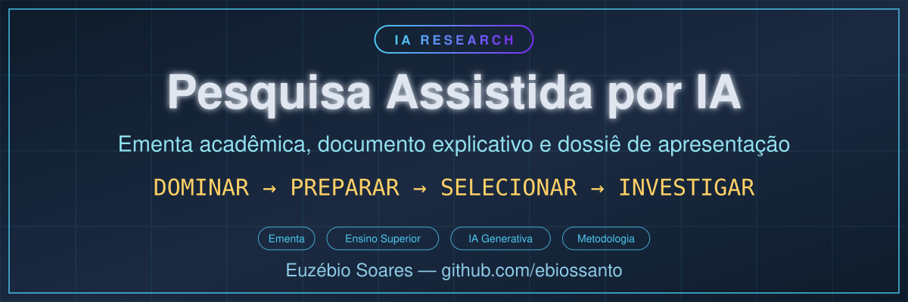

<p align="center">
  
</p>

# Pesquisa Assistida por Inteligência Artificial — Ementa e Dossiê de Apresentação

**Autor:** Euzébio Soares dos Santos · **Versão:** 1.0 — Outubro de 2026 · **Idioma:** português · **Repositório:** [`ebiossanto/IA-RESEARCH-PESQUISA-ASSISTIDA`](https://github.com/ebiossanto/IA-RESEARCH-PESQUISA-ASSISTIDA)

> **Citar este repositório:** use o [CITATION.cff](CITATION.cff) (botão *Cite this repository*)
> ou a seção [Citação](#citação) ao pé desta página.

Proposta de disciplina de **32 horas (8 encontros de 4 h)** para cursos de graduação, técnicos,
extensão e formação inicial em pesquisa. Ensina a usar inteligência artificial dentro de um
processo de investigação verificável, em quatro movimentos:

```
DOMINAR  →  PREPARAR  →  SELECIONAR  →  INVESTIGAR
conceitos     ambiente      ferramenta      pergunta,
e história     e segurança   e IA adequada   hipótese, método
```

---

## 1. O que há neste repositório

| Arquivo | O que é |
|---|---|
| [`ementa/EMENTA_PESQUISA_ASSISTIDA_IA_v1.0.md`](ementa/EMENTA_PESQUISA_ASSISTIDA_IA_v1.0.md) | **O trabalho.** Ementa acadêmica (Parte I), documento explicativo (Parte II) e bibliografia básica com articulação teórica (Parte III). |
| [`apresentacao/01_CARTA_DE_ENCAMINHAMENTO.md`](apresentacao/01_CARTA_DE_ENCAMINHAMENTO.md) | Carta para direção / colegiado de curso, com o pedido concreto de avaliação. |
| [`apresentacao/02_SINTESE_PARA_COMISSAO.md`](apresentacao/02_SINTESE_PARA_COMISSAO.md) | Síntese de 1 página: problema, objetivos, grade, avaliação, fundamentação e requisitos. |
| [`apresentacao/03_ROTEIRO_APRESENTACAO_20MIN.md`](apresentacao/03_ROTEIRO_APRESENTACAO_20MIN.md) | Roteiro de 12 blocos / 20 minutos, com respostas às perguntas prováveis. |
| [`apresentacao/Dossie_Pesquisa_Assistida_IA.pdf`](apresentacao/Dossie_Pesquisa_Assistida_IA.pdf) | Dossiê completo em PDF (carta + ementa + documento explicativo + bibliografia) — pronto para anexar ou imprimir. |
| [`references.bib`](references.bib) | As quatro obras básicas em BibTeX. |
| [`CITATION.cff`](CITATION.cff) | Como citar este repositório. |

## 2. A disciplina em resumo

| Item | Descrição |
|---|---|
| Nome | Pesquisa Assistida por Inteligência Artificial |
| Carga horária | 32 horas — 8 encontros de 4 horas |
| Natureza | Teórico-prática, em formato de laboratório |
| Público-alvo | Graduação, cursos técnicos, extensão e pesquisadores iniciantes |
| Produto final | Ambiente computacional organizado + plano de investigação assistida por IA |
| Avaliação | Conceitos e história 25% · Ambiente e ferramentas 20% · Interação e auditoria da IA 25% · Plano de investigação 30% |

### As 8 aulas

| Aula | Tema | Produto |
|---|---|---|
| 1 | Do tema aos conceitos | Ficha conceitual inicial |
| 2 | História do problema e formação do método | Linha histórico-conceitual |
| 3 | Construção do ambiente de pesquisa | Ambiente organizado e funcional |
| 4 | Ferramentas para cada tarefa | Mapa pessoal de ferramentas |
| 5 | Interação produtiva com IA | Registro comparativo de interações |
| 6 | Auditoria, verificação e alucinações | Relatório de auditoria |
| 7 | Pergunta, hipótese e método | Núcleo da investigação |
| 8 | Plano integrado de investigação | Plano final de investigação |

## 3. Bibliografia básica

- **AMBROSE**, Susan A.; **BRIDGES**, Michael W.; **DiPIETRO**, Michele; **LOVETT**, Marsha C.; **NORMAN**, Marie K. *How Learning Works: Seven Research-Based Principles for Smart Teaching*. San Francisco: Jossey-Bass, 2010.
- **BOOTH**, Wayne C.; **COLOMB**, Gregory G.; **WILLIAMS**, Joseph M. *A arte da pesquisa*. 3. ed. São Paulo: Martins Fontes, 2019.
- **UNESCO**. *Guia para a IA generativa na educação e na pesquisa*. Paris: UNESCO, 2024.
- **WILSON**, John. *Pensar com conceitos*. Tradução de Waldéa Barcellos. São Paulo: Martins Fontes, 2001.

### Onde cada obra sustenta a proposta

| Obra | Papel | Onde aparece |
|---|---|---|
| WILSON (2001) | Análise de conceitos: definir, exemplificar, contraprovar, relacionar | Aulas 1–2 · Parte II §3 |
| AMBROSE *et al.* (2010) | Sete princípios de ensino baseados em pesquisa | Parte I §8–§9 · sequência das aulas |
| UNESCO (2024) | IA generativa crítica, verificável e humana na educação | Parte II §1 · §5–§7 |
| BOOTH *et al.* (2019) | Do interesse ao problema, da pergunta à hipótese e à evidência | Aulas 7–8 · Parte II §8–§9 |

## 4. Como apresentar esta proposta a uma instituição

1. Envie a **carta de encaminhamento** (`apresentacao/01_...md`) com o **dossiê em PDF** anexado.
2. Entregue a **síntese para comissão** (`apresentacao/02_...md`) como material de leitura de 1 página.
3. Apresente em 20 minutos com o **roteiro** (`apresentacao/03_...md`), que já traz as respostas às perguntas prováveis.
4. Anexe a **ementa completa** (`ementa/...md`) como documentação curricular oficial.

Para regenerar o PDF após editar a ementa:

```bash
cd apresentacao
pdflatex dossie.tex
pdflatex dossie.tex      # segunda passada: sumário e referências cruzadas
```

## 5. Padrão do portfólio

Este repositório segue o padrão dos demais do portfólio **IA RESEARCH**:
banner em `assets/banner.svg` (gerado por `_padroes/gen_banner.py`), `CITATION.cff`,
`README.md` como mapa do projeto, `LICENSE` e `references.bib`.

```bash
python _padroes/gen_banner.py --config _padroes/banners.json --out-root . --only IA-RESEARCH-PESQUISA-ASSISTIDA
python _padroes/check_banners.py
```

## Citação

```bibtex
@misc{soares2026pesquisaassistida,
  title        = {Pesquisa Assistida por Inteligência Artificial: ementa acadêmica e documento explicativo},
  author       = {Soares, Euz{\'e}bio},
  year         = {2026},
  version      = {1.0},
  howpublished = {\url{https://github.com/ebiossanto/IA-RESEARCH-PESQUISA-ASSISTIDA}},
  note         = {Proposta de disciplina de 32 horas}
}
```

## Licença

MIT — ver [`LICENSE`](LICENSE).
